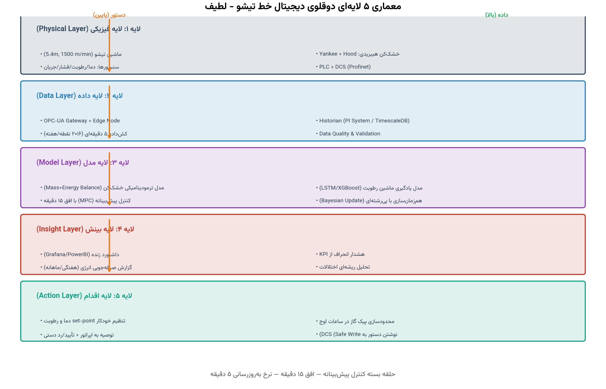
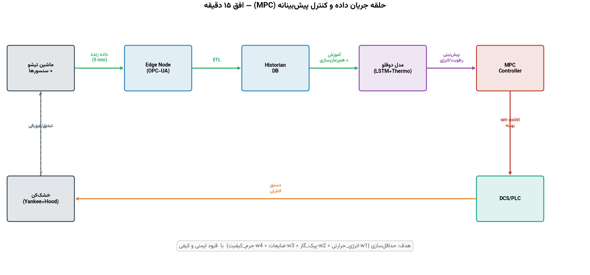
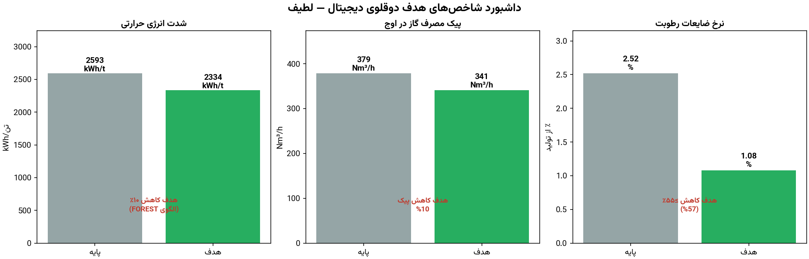
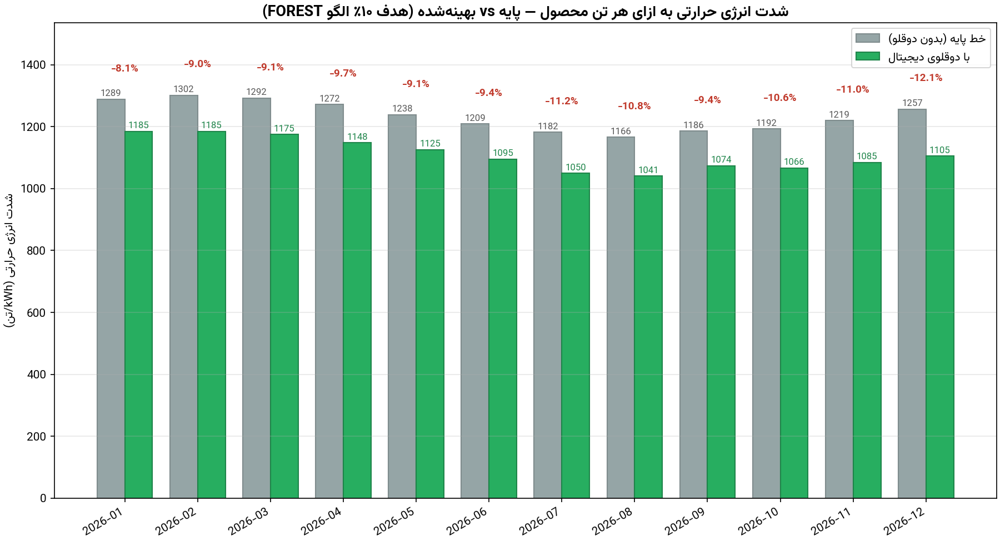
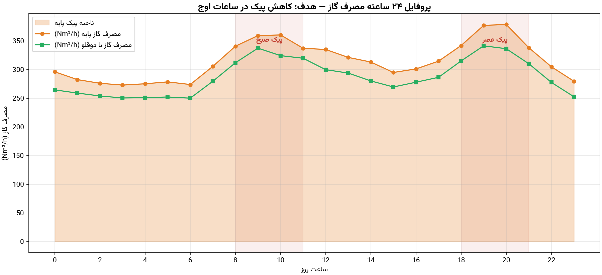
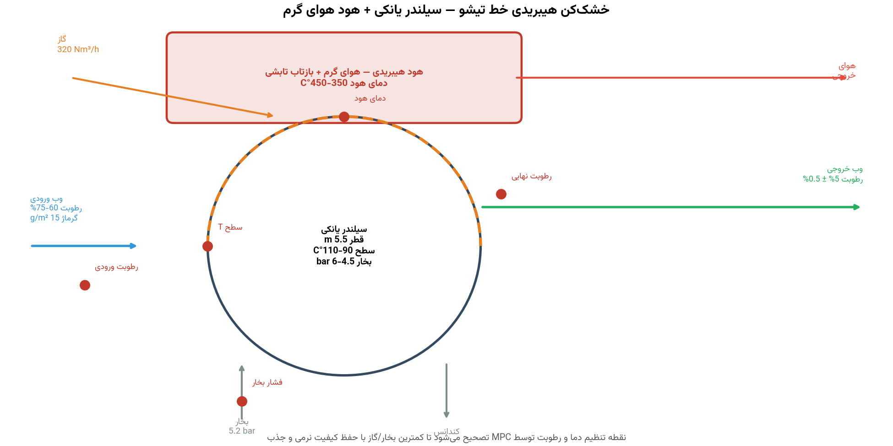
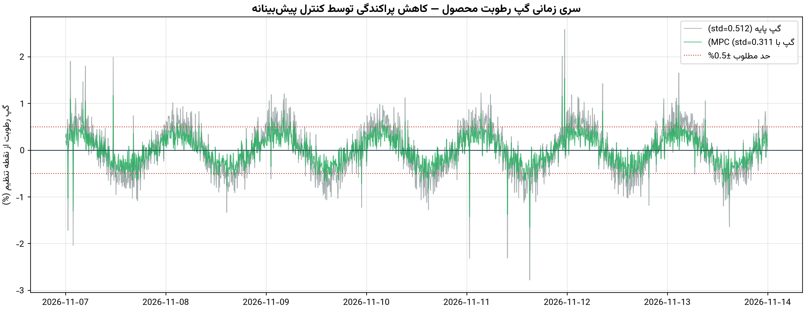
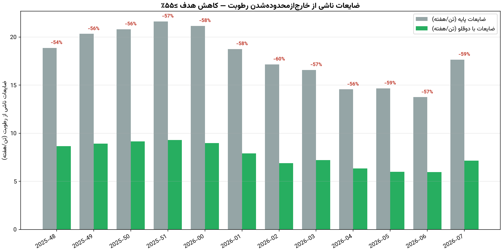

# سند نیازمندی‌های نرم‌افزاری (SRS)
## دوقلوی دیجیتال خط تیشو با کنترل پیش‌بینانه خشک‌کن
### محصولات کاغذی لطیف (تولید کاغذ بهداشتی/تیشو)

---

| فیلد | مقدار |
|---|---|
| **شناسه سند** | LATIF-SRS-2026-001 |
| **نسخه** | ۱.۰ |
| **تاریخ انتشار** | ۱۴۰۵/۰۸/۲۴ (۲۰۲۶-۱۱-۱۴) |
| **الگوی مستندسازی** | IEEE Std 830-1998 |
| **تهیه‌کننده** | تیم مهندسی نرم‌افزار لطیف |
| **مالک فنی** | مدیر فناوری اطلاعات و اتوماسیون (CTO) |
| **مرجع کسب‌وکار** | LATIF-BRS-2026-001 v1.0 |
| **وضعیت** | تأییدشده برای ورود به فاز طراحی |
| **زبان** | فارسی |
| **محرم خصوصی** | داخلی - لطیف |

---

## فهرست

1. مقدمه
2. توصیف کلی
3. نیازمندی‌های عملکردی
4. نیازمندی‌های رابط (Interfaces)
5. نیازمندی‌های عملکرد (Performance)
6. نیازمندی‌های منطق طراحی (Design Constraints)
7. ویژگی‌های نرم‌افزاری (Software Attributes)
8. نیازمندی‌های غیرعملکردی دیگر
9. پیوست‌ها

---

## ۱. مقدمه (Introduction)

### ۱.۱ هدف سند
این سند نیازمندی‌های نرم‌افزاری (SRS) برای **دوقلوی دیجیتال خط تیشو با کنترل پیش‌بینانه خشک‌کن** را به‌صورت کامل، بدون ابهام و قابل آزمون بیان می‌کند. مخاطب‌های این سند: تیم توسعه نرم‌افزار، مهندسان اتوماسیون، تست‌کنندگان، مدیر پروژه و ذی‌نفعان کسب‌وکار هستند. هدف نهایی سند این است که خواننده با خواندن آن بداند دقیقاً چه چیزی باید ساخته شود و چگونه باید آن را آزمود.

### ۱.۲ دامنه سند
دامنه این سند نرم‌افزار دوقلوی دیجیتال است که در فاز Pilot روی ماشین تیشوی فعلی لطیف (گرماژ ۱۵ g/m²، عرض ۵.۴ m، سرعت ۱۵۰۰ m/min) مستقر می‌شود. این نرم‌افزار داده‌های سنسور خشک‌کن را جمع‌آوری، پردازش و مدل‌سازی می‌کند، با کنترل‌کننده پیش‌بینانه (MPC) نقطه تنظیم بهینه را محاسبه و از طریق OPC-UA به DCS موجود می‌نویسد، و داشبورد و گزارش‌های مدیریتی ارائه می‌دهد.

### ۱.۳ تعاریف، اختصارات و واژه‌نامه
در ادامه فهرست اختصارات و تعاریف کلیدی آورده شده است. واژه‌نامه کامل در پیوست ۹.۱ آمده است.

| اصطلاح/اختصار | تعریف |
|---|---|
| **SRS** | Software Requirements Specification — همین سند |
| **BRS** | Business Requirements Specification — سند نیازمندی‌های کسب‌وکار مرجع |
| **DT** | Digital Twin — دوقلوی دیجیتال |
| **MPC** | Model Predictive Control — کنترل پیش‌بینانه مدل‌محور |
| **DCS/PLC** | Distributed Control System / Programmable Logic Controller — سامانه کنترل توزیع‌شده موجود |
| **OPC-UA** | OPC Unified Architecture — پروتکل تبادل داده صنعتی |
| **Historian** | پایگاه داده سری‌زمانی صنعتی برای ذخیره بلندمدت سنسورها |
| **Edge Node** | گره محاسباتی صنعتی کنار ماشین |
| **Advisory/Auto Mode** | حالت پیشنهادی به اپراتور / حالت کنترل خودکار |
| **Safe Write** | نوشتن set-point به DCS با قیود ایمنی و محدوده مجاز |
| **Yankee** | سیلندر بزرگ خشک‌کن با بخار |
| **Hood** | هود هوای گرم بالای Yankee |
| **KPI** | Key Performance Indicator — شاخص کلیدی عملکرد |
| **RMSE** | Root Mean Square Error — ریشه میانگین مربعات خطا |
| **Out-of-Spec** | رطوبت نهایی خارج از بازه ۳-۷٪ |
| **Softness** | نرمی محصول (مقیاس ۱-۱۰) |
| **Capillary Rise** | ارتفاع مویینگی — معیار جذب (mm) |

### ۱.۴ مراجع
1. **LATIF-BRS-2026-001 v1.0** — سند نیازمندی‌های کسب‌وکار لطیف.
2. **IEEE Std 830-1998** — Recommended Practice for Software Requirements Specifications.
3. **IEC 62443** — Security for Industrial Automation and Control Systems.
4. **IEC 61511** — Functional Safety: Safety Instrumented Systems for the Process Industry Sector.
5. **ISO 50001** — Energy Management Systems.
6. **OPC UA Specification Part 1-14** — OPC Foundation.
7. **FOREST Project** — پروژه مرجع آلمانی دوقلوی دیجیتال ماشین تیشو (الگوی ۱۰٪ صرفه‌جویی).
8. داده سنتتیک تولیدشده: `data/synthetic/*.csv` (توضیح در پیوست ۹.۳).

### ۱.۵ مرور کلی سند
بخش ۲ توصیف کلی، مفروضات و وابستگی‌ها را بیان می‌کند. بخش ۳ نیازمندی‌های عملکردی (Functional Requirements) را به‌صورت ۲۵ نیازمندی تست‌پذیر فهرست می‌کند. بخش ۴ رابط‌ها (کاربر، سخت‌افزار، نرم‌افزار، ارتباطات) را شرح می‌دهد. بخش ۵ نیازمندی‌های عملکرد (Performance) را کمی می‌کند. بخش ۶ محدودیت‌های طراحی، بخش ۷ ویژگی‌های نرم‌افزاری (قابلیت اطمینان، در دسترس بودن، امنیت و غیره) و بخش ۸ سایر نیازمندی‌های غیرعملکردی را پوشش می‌دهد.

---

## ۲. توصیف کلی (Overall Description)

### ۲.۱ دیدگاه محصول (Product Perspective)
نرم‌افزار دوقلوی دیجیتال یک سامانه جدید است که با سیستم‌های موجود (DCS، Historian موجود، شبکه Profinet) یکپارچه می‌شود و لایه‌های جدید داده، مدل، بینش و اقدام را به معماری لطیف اضافه می‌کند. شکل ۱ معماری ۵ لایه‌ای آن را نشان می‌دهد:



**شکل ۱ — معماری ۵ لایه‌ای دوقلوی دیجیتال لطیف**

لایه‌ها از پایین به بالا:
- **لایه ۱ — فیزیکی:** ماشین تیشو، خشک‌کن هیبریدی (Yankee + Hood)، سنسورها، DCS/PLC موجود.
- **لایه ۲ — داده:** Edge Node + OPC-UA Gateway، Historian (TimescaleDB)، اعتبارسنجی داده.
- **لایه ۳ — مدل:** مدل ترمودینامیکی، مدل LSTM رطوبت، کنترل‌کننده MPC، هم‌زمان‌سازی بیزی.
- **لایه ۴ — بینش:** داشبورد زنده، هشدارها، گزارش‌ها، تحلیل ریشه‌ای.
- **لایه ۵ — اقدام:** تنظیم خودکار set-point، محدودسازی پیک گاز، توصیه به اپراتور، نوشتن به DCS.

### ۲.۲ توابع محصول (Product Functions)
به‌صورت خلاصه، نرم‌افزار ۷ تابع اصلی دارد:
1. جمع‌آوری و ذخیره داده سنسورها از DCS از طریق OPC-UA.
2. پیش‌پردازش، پاکسازی و اعتبارسنجی داده.
3. اجرای مدل ترمودینامیکی خشک‌کن برای تخمین حالت داخلی.
4. اجرای مدل پیش‌بینانه رطوبت نهایی با افق ۱۵ دقیقه.
5. محاسبه set-point بهینه با MPC با کمینه‌سازی تابع هدف چندمتغیره.
6. اعمال set-point به DCS در حالت Advisory یا Auto (Safe Write).
7. نمایش داشبورد زنده و تولید گزارش‌های هفتگی/ماهانه.

شکل ۲ حلقه بسته کنترل پیش‌بینانه و جریان داده را نشان می‌دهد:



**شکل ۲ — حلقه جریان داده و کنترل پیش‌بینانه (MPC) با افق ۱۵ دقیقه**

### ۲.۳ ویژگی‌های کاربر (User Characteristics)
چهار گروه کاربری اصلی تعریف می‌شوند:

| کاربر | سطح دانش | نقش | نیازمندی دسترسی |
|---|---|---|---|
| اپراتور شیفت | آشنا با HMI صنعتی | نظارت و تأیید/رد پیشنهاد MPC | داشبورد ساده، تأیید/رد، مشاهده هشدار |
| مدیر تولید | دانش فنی متوسط | تصمیم شیفت، بررسی KPI | داشبورد، گزارش، تغییر مد | 
| مهندس فرآیند/اتوماسیون | دانش فنی پیشرفته | پیکربندی، آموزش مدل، عیب‌یابی | دسترسی کامل + پیکربندی مدل |
| مدیر ارشد/مالک کسب‌وکار | دانش عمومی | دیدگاه مالی و راهبردی | گزارش‌های اجرایی، KPI ماهانه |

### ۲.۴ مفروضات و وابستگی‌ها (Assumptions & Dependencies)
1. سنسورهای زیر در فاز صفر کالیبره و قابل اتکا می‌شوند: رطوبت ورودی، رطوبت نهایی، دمای هود، دمای سطح Yankee، فشار بخار، دبی بخار، دبی گاز، سرعت ماشین، گرماژ.
2. شبکه Profinet پایداری ≥۹۹.۵٪ دارد.
3. DCS موجود از OPC-UA Server پشتیبانی می‌کند یا یک Gateway اضافه می‌شود.
4. زیرساخت IT قابلیت میزبانی یک Edge Node صنعتی و یک سرور Historian را دارد.
5. واحد HSE پروتکل Safe Write را تأیید می‌کند.
6. اپراتورها در فاز آموزش شرکت می‌کنند و مایل به همکاری هستند.

### ۲.۵ محدودیت‌ها (Constraints)
- هیچ تغییر فیزیکی بزرگ در ماشین تیشو انجام نمی‌شود.
- نرم‌افزار نباید موجب توقف تولید بیش از ۴ ساعت برای راه‌اندازی شود.
- هیچ set-point از MPC نباید خارج از بازه مجاز تأییدشده توسط HSE اعمال شود.
- نرخ نوشتن به DCS نباید بیشتر از هر ۵ دقیقه یک‌بار باشد (نرخ کنترلی پایه).
- سیستم باید در صورت قطع ارتباط با Historian، به کار خود روی Edge Node ادامه دهد.
- همه داده‌های شخصی اپراتور مطابق قانون حفاظت از داده‌های شخصی ذخیره و افشا شوند.

---

## ۳. نیازمندی‌های عملکردی (Functional Requirements)

هر نیازمندی با شناسه یکتا `FR-x`، شرح، ورودی، خروجی، معیار پذیرش و اولویت مشخص شده است. اولویت‌ها: **M**=Must (الزامی)، **S**=Should (مهم)، **C**=Could (اختیاری)، **W**=Won't (آینده).

### ۳.۱ جمع‌آوری داده (Data Acquisition)

#### FR-1: استقرض داده سنسور از DCS از طریق OPC-UA
- **شرح:** نرم‌افزار باید حداقل ۱۸ متغیر سنسور را از OPC-UA Server موجود DCS با فاصله ۵ دقیقه بخواند.
- **ورودی:** آدرس OPC-UA، تگ‌های سنسور (جدول ۳-۱).
- **خروجی:** رکورد برچسب‌دار زمان‌دار برای هر سنسور.
- **معیار پذیرش:** تأخیر بین تولید داده در سنسور تا رسیدن به Edge Node ≤۶۰ ثانیه در ۹۹٪ نمونه‌ها.
- **اولویت:** M

**جدول ۳-۱ — فهرست سنسورهای مورد نیاز (ورودی OPC-UA)**

| ردیف | تگ پیشنهادی | متغیر | واحد | نرخ | حداقل دقت |
|---|---|---|---|---|---|
| ۱ | TT_HOOD_001 | دمای هود | °C | 5 min | ±۲°C |
| ۲ | TT_YANKEE_SRF_001 | دمای سطح Yankee | °C | 5 min | ±۱°C |
| ۳ | PT_STEAM_001 | فشار بخار Yankee | bar | 5 min | ±۰.۱ bar |
| ۴ | TT_HOT_AIR_001 | دمای هوای گرم ورودی هود | °C | 5 min | ±۳°C |
| ۵ | MT_MOIST_IN_001 | رطوبت ورودی | % | 5 min | ±۱.۵٪ |
| ۶ | MT_MOIST_OUT_001 | رطوبت نهایی | % | 5 min | ±۰.۲٪ |
| ۷ | WT_BASIS_001 | گرماژ | g/m² | 5 min | ±۰.۱ g/m² |
| ۸ | ST_SPEED_001 | سرعت ماشین | m/min | 5 min | ±۵ m/min |
| ۹ | FT_STEAM_001 | دبی بخار | t/h | 5 min | ±۰.۱ t/h |
| ۱۰ | FT_GAS_001 | دبی گاز | Nm³/h | 5 min | ±۵ Nm³/h |
| ۱۱ | TT_AMB_001 | دمای محیط | °C | 15 min | ±۱°C |
| ۱۲ | RH_AMB_001 | رطوبت نسبی محیط | % | 15 min | ±۳٪ |
| ۱۳ | PT_AIR_HOOD_001 | فشار هوای هود | kPa | 5 min | ±۰.۲ kPa |
| ۱۴ | LT_YANKEE_COND_001 | سطح کندانس Yankee | % | 15 min | ±۲٪ |
| ۱۵ | FT_WATER_IN_001 | دبی آب ورودی به بخش فرم‌گیری | m³/h | 15 min | ±۰.۵ m³/h |
| ۱۶ | TT_WATER_IN_001 | دمای آب ورودی | °C | 15 min | ±۱°C |
| ۱۷ | ET_PRODUCTION_STATUS | وضعیت تولید (Run/Stop) | enum | event | — |
| ۱۸ | ET_SHIFT_ID | شناسه شیفت فعلی | enum | event | — |

#### FR-2: کش‌داده محلی روی Edge Node
- **شرح:** در صورت قطع ارتباط Edge Node با Historian، داده‌ها باید به‌صورت محلی روی Edge Node با بافر حداقل ۷ روز ذخیره شوند و پس از بازگشت ارتباط، خودکار به Historian ارسال شوند.
- **ورودی:** داده خام سنسور + وضعیت ارتباط.
- **خروجی:** بافر محلی + همگام‌سازی بعد از بازگشت.
- **معیار پذیرش:** هیچ داده‌ای در قطعی تا ۷ روز از دست نمی‌رود؛ در بازگشت ارتباط، بافر در کمتر از ۱۰ دقیقه خالی می‌شود.
- **اولویت:** M

#### FR-3: علامت‌گذاری وضعیت تولید
- **شرح:** نرم‌افزار باید رکوردهایی که در زمان توقف تولید ثبت شده‌اند با پرچم `production_status = Stop` علامت‌گذاری کند و آن‌ها را از آموزش مدل و محاسبه KPI جدا کند.
- **ورودی:** تگ ET_PRODUCTION_STATUS.
- **خروجی:** برچسب کیفیت رکورد.
- **معیار پذیرش:** ۱۰۰٪ رکوردهای زمان توقف به‌درستی برچسب‌گذاری شوند.
- **اولویت:** M

### ۳.۲ پیش‌پردازش و اعتبارسنجی داده

#### FR-4: تشخیص و برچسب داده خارج از محدوده (Out-of-Range)
- **شرح:** برای هر سنسور یک بازه فیزیکی مجاز تعریف شود (مثلاً رطوبت ۰-۱۰۰٪، دمای هود ۲۰-۶۰۰°C). هر مقدار خارج از این بازه باید با پرچم `out_of_range` برچسب‌گذاری شود و با آخرین مقدار معتبر جایگزین شود (Hold Last Good Value).
- **معیار پذیرش:** ۱۰۰٪ داده خارج‌از‌محدوده برچسب‌گذاری شود؛ درصد داده جایگزین‌شده در گزارش کیفیت داده گزارش شود.
- **اولویت:** M

#### FR-5: تشخیص داده تکراری (Frozen Sensor)
- **شرح:** اگر مقدار یک سنسور در ۳ گام پیاپی (۱۵ دقیقه) بدون تغییر باشد، نرم‌افزار باید آن را با پرچم `frozen` برچسب‌گذاری و در داشبورد هشدار دهد.
- **معیار پذیرش:** تأخیر هشدار ≤۲۰ دقیقه از آغاز توقف سنسور.
- **اولویت:** M

#### FR-6: جبران‌سازی داده گمشده (Imputation)
- **شرح:** شکستگی‌های کوتاه (≤۳ گام = ۱۵ دقیقه) در یک سنسور باید با درون‌یابی خطی پر شوند و با پرچم `imputed` برچسب‌گذاری شوند. شکستگی‌های بلندتر باید با `null` و پرچم `missing` نگه‌داری شوند و در آموزش مدل نادیده گرفته شوند.
- **معیار پذیرش:** دقت درون‌یابی برای شکستگی ۱۵ دقیقه‌ای در رطوبت نهایی با RMSE ≤۰.۲٪.
- **اولویت:** S

#### FR-7: گزارش کیفیت داده
- **شرح:** نرم‌افزار باید روزانه گزارشی از کیفیت داده شامل درصد داده خارج‌از‌محدوده، تکراری، گمشده و جایگزین‌شده تولید کند.
- **معیار پذیرش:** گزارش روزانه تا ساعت ۰۷:۰۰ بامداد در دسترس باشد.
- **اولویت:** M

### ۳.۳ مدل ترمودینامیکی و دوقلوی دیجیتال

#### FR-8: مدل ترمودینامیکی خشک‌کن
- **شرح:** نرم‌افزار باید یک مدل مبتنی بر تراز جرم و انرژی از خشک‌کن هیبریدی پیاده‌سازی کند که جریان انرژی، جرم آب و CO₂ را در هر گام ۵ دقیقه‌ای محاسبه کند.
- **ورودی:** داده سنسور (دما، دبی، رطوبت ورودی/خروجی، سرعت، گرماژ).
- **خروجی:** تخمین پروفایل رطوبت در طول مسیر، انرژی حرارتی تجمعی، انتشار CO₂.
- **معیار پذیرش:** خطای تخمین رطوبت خروجی میانگین (نسبت به سنسور واقعی) ≤۰.۳٪ در ۹۰٪ گام‌ها.
- **اولویت:** M

#### FR-9: مدل پیش‌بینانه رطوبت نهایی (LSTM)
- **شرح:** نرم‌افزار باید یک مدل یادگیری ماشین (LSTM یا XGBoost) آموزش دهد که با گرفتن ۳۰ دقیقه گذشته، رطوبت نهایی را در افق ۱۵ دقیقه (۳ گام پیش‌بینی) پیش‌بینی کند.
- **ورودی:** سری زمانی ۳۰ دقیقه‌ای گذشته سنسورها.
- **خروجی:** پیش‌بینی رطوبت نهایی در t+5، t+10، t+15 دقیقه.
- **معیار پذیرش:** RMSE پیش‌بینی t+15 ≤۰.۳٪ روی داده آزمون.
- **اولویت:** M

#### FR-10: هم‌زمان‌سازی مدل (Model Sync)
- **شرح:** نرم‌افزار باید مدل LSTM را روزانه با داده ۲۴ ساعت گذشته به‌روزرسانی کند (آموزش تدریجی) و در صورت تورم اندازهgل داده، آن را علامت‌گذاری کند.
- **معیار پذیرش:** زمان آموزش تدریجی ≤۳۰ دقیقه، بدون قطع کنترل Auto.
- **اولویت:** M

#### FR-11: محاسبه شدت انرژی حرارتی
- **شرح:** نرم‌افزار باید به‌صورت پیوسته `thermal_energy_intensity = (steam_flow × 2200 + gas_flow × 9.5) / production` را محاسبه و ذخیره کند.
- **معیار پذیرش:** مطابقت ±۱٪ با محاسبه دستی روی داده سنتتیک مرجع (`dryer_sensors_timeseries.csv`).
- **اولویت:** M

### ۳.۴ کنترل پیش‌بینانه (MPC)

#### FR-12: تابع هدف MPC
- **شرح:** نرم‌افزار باید در هر گام کنترلی (۵ دقیقه)، مسأله بهینه‌سازی زیر را حل کند:

```
min  J = Σ [ w1·E(t+k) + w2·P_gas(t+k) + w3·Waste(t+k) + w4·ΔSP(t+k)² ]
s.t. :
  safety constraints
  3% ≤ moisture_out_pred(t+k) ≤ 7%
  hood_temp_min ≤ SP_hood(t+k) ≤ hood_temp_max
  yankee_steam_min ≤ SP_steam(t+k) ≤ yankee_steam_max
  |ΔSP| ≤ ΔSP_max  (نرخ تغییر)
  softness_pred ≥ 7.5
  capillary_rise_pred ≥ 80 mm
k = 0..N (N=3, افق ۱۵ دقیقه)
```

- **معیار پذیرش:** راه‌حل MPC در ۹۰٪ گام‌ها در ≤۱۰ ثانیه محاسبه شود.
- **اولویت:** M

#### FR-13: خروجی set-point
- **شرح:** MPC باید در هر گام، مقادیر بهینه‌ی set-point برای دمای هود و فشار بخار Yankee را به‌عنوان خروجی نهایی تولید کند.
- **ورودی:** وضعیت فعلی + پیش‌بینی مدل.
- **خروجی:** SP_hood_opt, SP_steam_opt برای گام بعد.
- **معیار پذیرش:** خروجی همیشه در محدوده مجاز HSE (جدول ۴-۱) باشد.
- **اولویت:** M

#### FR-14: حالت Advisory
- **شرح:** در حالت Advisory، نرم‌افزار باید set-point پیشنهادی را روی داشبورد اپراتور نمایش دهد و منتظر تأیید یا رد اپراتور بماند.
- **معیار پذیرش:** نمایش پیشنهاد در ≤۳۰ ثانیه از محاسبه، انتظار تأیید بدون تایم‌اوت.
- **اولویت:** M

#### FR-15: حالت Auto (Safe Write)
- **شرح:** در حالت Auto، نرم‌افزار باید set-point محاسبه‌شده را پس از اعمال قیود ایمنی، با فاصله حداقل ۵ دقیقه از دستور قبلی به DCS بنویسد. هر دستور نوشتن باید در یک جدول ممیزی (Audit Log) ثبت شود.
- **معیار پذیرش:** ۱۰۰٪ دستورات در Audit Log ثبت شوند؛ تأخیر نوشتن ≤۵ ثانیه؛ هیچ دستوری خارج از محدوده HSE نوشته نشود.
- **اولویت:** M

#### FR-16: Fallback به حالت اپراتور
- **شرح:** در صورت خطای مدل (RMSE پیش‌بینی > ۰.۵٪ در پنجره ۳۰ دقیقه‌ای) یا قطع ارتباط با DCS، نرم‌افزار باید به‌صورت خودکار به حالت "اپراتور دستی" سوییچ کند و هشدار بحرانی بدهد.
- **معیار پذیرش:** تأخیر سوییچ ≤۶۰ ثانیه از رخداد خطا؛ اپراتور در ≤۱۰ ثانیه مطلع شود.
- **اولویت:** M

#### FR-17: محدودسازی پیک گاز
- **شرح:** نرم‌افزار باید در ساعات اوج شبکه گاز (۸-۱۱ و ۱۸-۲۱) نرم‌ترم محدودیت سخت‌تری روی `gas_flow` اعمال کند (کاهش حد مجاز پلکانی).
- **معیار پذیرش:** پیک مصرف گاز در ساعات اوج کاهش ≥۹٪ نسبت به خط پایه.
- **اولویت:** S

### ۳.۵ داشبورد و رابط کاربری

#### FR-18: داشبورد عملیاتی زنده
- **شرح:** نرم‌افزار باید یک داشبورد زنده با نمودارها و فیلدهای کلیدی برای اپراتور فراهم کند: رطوبت فعلی و هدف، پیش‌بینی ۱۵ دقیقه، set-point فعلی و پیشنهادی، مصرف زنده بخار/گاز، KPI ها، هشدارها.
- **معیار پذیرش:** تأخیر نمایش داده ≤۱۰ ثانیه از ثبت در Edge Node؛ نمودار ۲۴ ساعت گذشته.
- **اولویت:** M

#### FR-19: تأیید/رد پیشنهاد MPC
- **شرح:** در حالت Advisory، داشبورد باید دکمه‌های "تأیید" و "رد" با ثبت شناسه اپراتور و زمان را فراهم کند.
- **معیار پذیرش:** ثبت ۱۰۰٪ تصمیمات در Audit Log.
- **اولویت:** M

#### FR-20: هشدارها و رویدادها
- **شرح:** نرم‌افزار باید هشدارها را در سه سطح (اطلاع، هشدار، بحرانی) با پنجره رویدادهای ۳۰ روزه و فیلتر بر اساس نوع/سطح نمایش دهد.
- **معیار پذیرش:** هر هشدار ≤۱۰ ثانیه پس از رخداد در داشبورد ظاهر شود.
- **اولویت:** M

### ۳.۶ گزارش‌داه و KPI

#### FR-21: گزارش هفتگی صرفه‌جویی
- **شرح:** نرم‌افزار باید یک گزارش هفتگی خودکار شامل: میانگین شدت انرژی، پیک گاز، نرخ ضایعات، نرخ Auto Mode، رویدادهای خارج از محدوده و نمودارهای روند تولید کند.
- **معیار پذیرش:** گزارش هر روز شنبه ساعت ۰۷:۰۰ در دسترس مدیران باشد.
- **اولویت:** M

#### FR-22: گزارش ماهانه اجرایی
- **شرح:** نرم‌افزار باید یک گزارش ماهانه اجرایی شامل: KPI های BO-1 تا BO-6، صرفه‌جویی مالی، gCO₂/t، مقایسه با خط پایه و پیشنهادها تولید کند.
- **معیار پذیرش:** گزارش تا روز ۳ هر ماه در دسترس مدیر ارشد باشد.
- **اولویت:** S

#### FR-23: داشبورد KPI های هدف
- **شرح:** داشبورد باید شامل سه KPI اصلی (شدت انرژی، پیک گاز، ضایعات رطوبت) به‌صورت متمرکز و مقایسه پایه/هدف باشد (شکل ۳).



**شکل ۳ — داشبورد شاخص‌های هدف (KPI) دوقلوی دیجیتال لطیف**

- **معیار پذیرش:** هر سه KPI در داشبورد زنده به‌روزرسانی شوند.
- **اولویت:** M

### ۳.۷ مدیریت و امنیت

#### FR-24: مدیریت کاربران و نقش‌ها
- **شرح:** نرم‌افزار باید نقش‌ها (اپراتور، مدیر تولید، مهندس، مدیر ارشد) با سطح دسترسی مجزا و احراز هویت با نام کاربری/گذرواژه یا SSO سازمانی پیاده‌سازی کند.
- **معیار پذیرش:** مطابقت با IEC 62443؛ همه تلاش‌های ورود در Audit Log.
- **اولویت:** M

#### FR-25: ممیزی و عیب‌یابی
- **شرح:** نرم‌افزار باید یک Audit Log با حداقل ۹۰ روز نگه‌داری برای: تغییر set-point، تأیید/رد اپراتور، تغییر مد، خطاها و ورود/خروج کاربر فراهم کند.
- **معیار پذیرش:** هر رویداد ≤۲ ثانیه در Log ثبت شود؛ جستجو بر اساس کاربر/زمان/نوع.
- **اولویت:** M

---

## ۴. نیازمندی‌های رابط (Interface Requirements)

### ۴.۱ رابط‌های کاربری (User Interfaces)

#### UI-1: داشبورد اپراتور
- نمایش تمام‌صفحه روی مانیتور ۲۷ اینچی کنار پلتفرم اپراتور.
- تم با کنتراست بالا برای محیط کارخانه؛ فونت فارسی Vazirmatn با اندازه حداقل ۱۴px.
- منوی راست‌چین و دکمه‌های بزرگ (≥۴۸px ارتفاع) برای کار با دستکش.
- نمایش مد کنترل (Auto/Advisory/Manual) با رنگ متمایز (سبز/زرد/قرمز).

#### UI-2: داشبورد مدیر تولید
- وب‌محور، قابل مشاهده روی تبلت و لپ‌تاپ.
- نمودارهای روند ۲۴ ساعته/هفتگی/ماهانه با امکان Zoom.
- فیلتر بر اساس شیفت و تاریخ.

#### UI-3: گزارش اجرایی
- خروجی PDF و Excel با نمودارهای گرافیکی.
- ارسال خودکار ایمیل به مدیر ارشد.

#### UI-4: پنل پیکربندی مهندس
- دسترسی فقط با احراز هویت دو مرحله‌ای.
- ویرایش وزن‌های تابع هدف MPC، محدوده‌های ایمنی و پارامترهای مدل.
- تأیید هر تغییر با دیدگاه دوم (Four-Eyes).

### ۴.۲ رابط‌های سخت‌افزاری (Hardware Interfaces)

#### HI-1: OPC-UA Server موجود DCS
- پروتکل: OPC-UA over TCP (Port 4840).
- امنیت: Sign+Encrypt256 (طبق IEC 62443).
- گزینه‌های احراز: Username/Password با گواهی X.509.
- متغیرها: مطابق جدول ۳-۱ (۱۸ تگ).

#### HI-2: Edge Node صنعتی
- حداقل مشخصات: ۸ هسته CPU، ۳۲GB RAM، ۵۱۲GB SSD، دو کارت شبکه صنعتی (Profinet + Ethernet)، پشتیبانی دمای ۰-۶۰°C، تغذیه با UPS.

#### HI-3: سرور Historian
- مشخصات: ۱۶ هسته، ۶۴GB RAM، ۲TB SSD RAID-1، سیستم‌عامل Linux (Ubuntu 22.04 LTS یا RHEL 9).

#### HI-4: کالیبراسیون سنسور
- سنسورهای رطوبت نهایی: نوع NIR (نزدیک مادون قرمز) با دقت ±۰.۲٪.
- سایر سنسورها طبق جدول ۳-۱.

### ۴.۳ رابط‌های نرم‌افزاری (Software Interfaces)

#### SI-1: Historian (TimescaleDB)
- اسکیما `dryer_sensors` با جدول `timeseries` و پارتیشن ماهانه.
- رابط نوشتن از Edge Node با TLS.

#### SI-2: مدل یادگیری ماشین
- مدل LSTM با PyTorch یا TensorFlow Serving؛ رابط REST یا gRPC.
- مدل MPC با Python (CasADi یا GEKKO) یا Rust؛ رابط تابعی.

#### SI-3: داشبورد
- Grafana با TimescaleDB data source یا داشبورد سفارشی React.
- رابط نگاشت کاربر با Active Directory/LDAP سازمانی.

#### SI-4: سیستم ایمیل و نوتیفیکیشن
- SMTP برای ارسال گزارش‌ها.
- Webhook به Microsoft Teams یا Slack برای هشدارهای بحرانی.

#### SI-5: سیستم گزارش‌داه HSE و انرژی
- خروجی CSV ماهانه gCO₂/t و kWh/t برای گزارش ISO 50001 و ISO 14001.

### ۴.۴ رابط‌های ارتباطات (Communication Interfaces)

#### CI-1: شبکه صنعتی
- Profinet برای سنسورها → DCS.
- Ethernet صنعتی برای OPC-UA بین DCS و Edge Node.
- VLAN مجزا برای ترافیک دوقلو (IEC 62443).

#### CI-2: زمان‌سنجی
- همگام‌سازی زمان با NTP سرور سازمانی؛ اختلاف ≤۵۰ میلی‌ثانیه.

---

## ۵. نیازمندی‌های عملکرد (Performance Requirements)

### ۵.۱ تأخیر و پاسخ‌گویی

| شناسه | نیازمندی | مقدار هدف |
|---|---|---|
| P-1 | تأخیر سنسور → Edge Node | ≤۶۰ ثانیه (p99) |
| P-2 | تأخیر Edge → Historian | ≤۳۰ ثانیه (p99) |
| P-3 | زمان محاسبه MPC در هر گام | ≤۱۰ ثانیه (p90) |
| P-4 | زمان پیش‌بینی LSTM | ≤۲ ثانیه |
| P-5 | تأخیر نمایش داده در داشبورد | ≤۱۰ ثانیه |
| P-6 | تأخیر نوشتن set-point به DCS | ≤۵ ثانیه |
| P-7 | تأخیر هشدار بحرانی | ≤۱۰ ثانیه |

### ۵.۲ ظرفیت و مقیاس

| شناسه | نیازمندی | مقدار هدف |
|---|---|---|
| P-8 | نرخ ثبت داده | ۲۰۱۶ رکورد در روز (۱۸ سنسور × ۲۸۸ گام) |
| P-9 | نگه‌داری Historian | حداقل ۳ سال داده سنسور |
| P-10 | بافر محلی Edge | حداقل ۷ روز در قطعی |
| P-11 | کاربر هم‌زمان داشبورد | حداقل ۱۰ کاربر |
| P-12 | Audit Log نگه‌داری | حداقل ۹۰ روز |
| P-13 | تاریخچه هشدار | حداقل ۳۶۵ روز |

### ۵.۳ دقت مدل و کنترل

| شناسه | نیازمندی | مقدار هدف |
|---|---|---|
| P-14 | RMSE پیش‌بینی رطوبت (افق ۱۵ دقیقه) | ≤۰.۳٪ |
| P-15 | خطای تراز انرژی مدل ترمودینامیکی | ≤۳٪ |
| P-16 | انحراف معیار رطوبت نهایی (σ) | ≤۰.۳٪ (پس از ۶ ماه) |
| P-17 | نرخ رویداد خارج از محدوده | ≤۰.۱٪ از زمان |

### ۵.۴ KPI های عملکردی (مشترک با BRS)

| KPI | خط پایه | هدف | افق |
|---|---|---|---|
| شدت انرژی حرارتی (kWh/t) | ۲۵۹۳ | ≤۲۳۳۷ (کاهش ≥۱۰٪) | ۱۲ ماه |
| پیک مصرف گاز در اوج (Nm³/h) | ۴۶۰ | ≤۴۲۰ (کاهش ≥۹٪) | ۹ ماه |
| نرخ ضایعات رطوبت (٪ تولید) | ۲.۶٪ | ≤۱.۲٪ (کاهش ≥۵۵٪) | ۱۲ ماه |
| نرمی (۱-۱۰) | ۸.۰ | ≥۷.۵ | پیوسته |
| مویینگی (mm) | ۸۵ | ≥۸۰ | پیوسته |

نمودار شدت انرژی پایه vs بهینه‌شده در شکل ۴ آمده است:



**شکل ۴ — شدت انرژی حرارتی پایه vs بهینه‌شده در ۱۲ ماه (هدف ۱۰٪)**

و پروفایل پیک گاز ۲۴ ساعته در شکل ۵:



**شکل ۵ — پروفایل ۲۴ ساعته مصرف گاز — هدف کاهش پیک در ساعات اوج**

---

## ۶. نیازمندی‌های منطق طراحی (Design Constraints)

### ۶.۱ محدودیت‌های ایمنی (Safety Constraints)

**جدول ۴-۱ — محدوده‌های مجاز HSE برای set-point**

| متغیر | حد پایین | حد بالا | نرخ تغییر حداکثر |
|---|---|---|---|
| SP_hood_temp | ۳۰۰°C | ۴۸۰°C | ۲°C/دقیقه |
| SP_steam_pressure | ۴.۰ bar | ۶.۲ bar | ۰.۱ bar/دقیقه |
| SP_hot_air_temp | ۳۸۰°C | ۴۵۰°C | ۳°C/دقیقه |
| SP_machine_speed | ۱۳۵۰ m/min | ۱۶۰۰ m/min | ۵ m/min/دقیقه |

هر set-point تولیدشده توسط MPC باید این محدوده‌ها را به‌صورت سخت (hard constraint) رعایت کند. در صورت نقض، نرم‌افزار نباید دستور را به DCS بنویسد و باید در Audit Log ثبت و هشدار بحرانی بدهد.

### ۶.۲ محدودیت‌های معماری
- معماری لایه‌ای مطابق شکل ۱.
- هیچ وابستگی به سرویس ابری برای کنترل لحظه‌ای نباید وجود داشته باشد (Edge-first).
- مدل‌ها به‌صورت کانتینر (Docker) بسته‌بندی شوند.
- ذخیره‌سازی داده حساس باید درون مرز شبکه کارخانه باشد.

### ۶.۳ محدودیت‌های استاندارد
- رعایت IEC 62443 برای امنیت ICS (Segmentation، Authentication، Audit).
- رعایت IEC 61511 برای تعامل با SIS موجود (نرم‌افزار نباید SIS را دور بزند).
- رعایت ISO 50001 برای گزارش‌داه انرژی.

### ۶.۴ محدودیت‌های فناوری
- Backend: Python ۳.۱۱+ برای مدل‌سازی و کنترل؛ Go یا Python برای سرویس‌های داده.
- Frontend: React ۱۸+ یا Grafana.
- Database: TimescaleDB (PostgreSQL) برای سری زمانی.
- Containerization: Docker + Docker Compose (نسخه فاز Pilot).

---

## ۷. ویژگی‌های نرم‌افزاری (Software Attributes)

### ۷.۱ قابلیت اطمینان (Reliability)
- **R-1:** نرم‌افزار باید MTBF ≥ ۹۹.۵٪ در ۹۰ روز اول داشته باشد.
- **R-2:** در صورت خطای یک سرویس، سیستم باید با سرویس جایگزین ادامه دهد (Fail-Soft).
- **R-3:** در خطای بحرانی، Fallback به حالت اپراتور در ≤۶۰ ثانیه.

### ۷.۲ در دسترس بودن (Availability)
- **A-1:** هدف در دسترس بودن ۹۹.۵٪ در سال (حداکثر ۴۳.۸ ساعت قطعی سالانه برای نگهداری و خطا).
- **A-2:** هیچ نگهداری برنامه‌ریزی‌شده نباید در ساعات اوج باشد.

### ۷.۳ امنیت (Security)
- **S-1:** رعایت IEC 62443-3-3 Level ۲.
- **S-2:** همه ارتباطات با TLS 1.3.
- **S-3:** احراز هویت مرکزی با SSO سازمانی.
- **S-4:** Audit Log غیرقابل تغییر (Append-only).
- **S-5)** امنیت داده: رمزنگاری در حال استراحت (AES-256) برای داده شخصی.

### ۷.۴ قابلیت نگهداری (Maintainability)
- **M-1:** همه تغییرات پیکربندی از طریق نسخه‌گذاری Git انجام شوند.
- **M-2:** مستندسازی API با OpenAPI 3.0.
- **M-3:** زمان استقرار نسخه جدید ≤۳۰ دقیقه، بدون قطع کنترل Auto.

### ۷.۵ قابلیت انتقال (Portability)
- **P-1:** نرم‌افزار باید قابل استقرار روی Ubuntu 22.04 LTS و RHEL 9 باشد.
- **P-2:** کانتینرها باید روی هر runtime سازگار با OCI اجرا شوند.

### ۷.۶ کارایی (Usability)
- **U-1:** زمان یادگیری اپراتور برای عملکرد پایه ≤۴ ساعت.
- **U-2:** زمان انجام وظایف رایج (تأیید پیشنهاد، مشاهده KPI) ≤۳ کلیک.

---

## ۸. سایر نیازمندی‌های غیرعملکردی (Other Non-Functional Requirements)

### ۸.۱ محلی‌سازی (Localization)
- زبان پیش‌فرض: فارسی راست‌چین.
- تاریخ شمسی همراه با میلادی در گزارش‌ها.
- واحد‌ها: °C، bar، Nm³/h، kWh/t، g/m²، m/min.
- ارقام فارسی در گزارش‌های مدیریتی، ارقام لاتین در نمودارها.

### ۸.۲ رعایت حقوقی
- قانون حفاظت از داده‌های شخصی ایران برای داده اپراتور.
- آیین‌نامه ایمنی بخار و دیگ‌های بخار وزارت کار.
- مقررات تعرفه پلکانی شبکه گاز در ساعات اوج.

### ۸.۳ پایداری (Sustainability)
- نرم‌افزار باید گزارش ماهانه gCO₂/t را برای گزارش ISO 14001 تولید کند.
- ضریب تبدیل: هر Nm³ گاز = ۲.۰۴ kgCO₂ (معیار جهانی IPCC برای گاز طبیعی).

### ۸.۴ آموزش و اسناد
- **D-1:** راهنمای کاربر اپراتور به فارسی (حداقل ۳۰ صفحه).
- **D-۲:** راهنمای پیکربندی مهندس (حداقل ۶۰ صفحه).
- **D-۳:** راهنمای API و یکپارچه‌سازی (حداقل ۴۰ صفحه).
- **D-4:** دوره آموزشی ۸ ساعته برای اپراتورها و ۱۶ ساعته برای مهندسان.

### ۸.۵ پشتیبانی
- پشتیبانی فنی ۲۴/۷ در ۶ ماه نخست.
- زمان پاسخ بحرانی ≤۳۰ دقیقه، حل بحرانی ≤۴ ساعت.

---

## ۹. پیوست‌ها (Appendices)

### ۹.۱ واژه‌نامه کامل

| اصطلاح | تعریف |
|---|---|
| دوقلوی دیجیتال (Digital Twin) | نسخه دیجیتال هم‌زمان از دارایی فیزیکی که با دریافت داده زنده، رفتار آن را شبیه‌سازی و پیش‌بینی می‌کند. |
| کنترل پیش‌بینانه (MPC) | کنترل‌کننده‌ای که در هر گام با حل مسأله بهینه‌سازی با افق پیش‌بینی، بهترین دنباله کنترلی را محاسبه و اولین دستور را اعمال می‌کند. |
| خشک‌کن هیبریدی | ترکیب سیلندر یانکی (خشک‌کردن با بخار) و هود هوای گرم. |
| سیلندر یانکی | سیلندر بزرگ قطر ۵.۵ m با سطح صیقلی؛ با بخار گرم می‌شود. |
| هود | سقف بالای یانکی با هوای گرم و تابش. |
| گرماژ | جرم واحد سطح وب (g/m²). |
| شدت انرژی حرارتی | مجموع انرژی بخار و گاز به kWh به ازای هر تن محصول (kWh/t). |
| Advisory / Auto Mode | حالت پیشنهاد به اپراتور / حالت کنترل خودکار. |
| Safe Write | نوشتن set-point به DCS با اعمال قیود ایمنی. |
| Out-of-Spec | رویداد خارج از محدوده رطوبت (۳-۷٪). |
| Softness | نرمی محصول در مقیاس ۱-۱۰. |
| Capillary Rise | ارتفاع مویینگی، معیار جذب (mm). |
| RMSE | ریشه میانگین مربعات خطا. |
| MTBF | Mean Time Between Failures. |
| Historian | پایگاه داده سری‌زمانی صنعتی. |
| Edge Node | گره محاسباتی صنعتی کنار ماشین. |
| FOREST | پروژه آلمانی مرجع دوقلوی دیجیتال ماشین تیشو. |

### ۹.۲ تحلیل‌ها (Issues/Decisions Pending)

| ردیف | موضوع | توضیح | تصمیم |
|---|---|---|---|
| ۱ | انتخاب فناوری Historian | TimescaleDB vs PI System | TimescaleDB برای فاز Pilot (مزیت Open Source) |
| ۲ | انتخاب فریم‌ورک مدل | PyTorch vs TensorFlow Serving | PyTorch به‌دلیل انعطاف مدل ترکیبی |
| ۳ | انتخاب MPC solver | CasADi vs GEKKO vs acados | CasADi به‌دلیل گستره وسیع‌تر |
| ۴ | ساختار داشبورد | Grafana vs سفارشی React | Grafana برای فاز Pilot، React برای فاز بهره‌برداری |
| ۵ | استقرار مدل | کانتینر یا bare-metal | کانتینر Docker Compose |
| ۶ | تأییدیه HSE برای Safe Write | در فاز ۰ | مرتبط با واحد HSE |

### ۹.۳ توضیح داده سنتتیک مرجع

داده‌های سنتتیک تولیدشده با اسکریپت `scripts/generate_synthetic_data.py` برای فاز توسعه و اعتبارسنجی استفاده می‌شوند. این داده‌ها بر اساس مدل‌های فیزیکی (نوسان روزانه، شیفت‌بندی، نویز سنسور، اختلال گاه‌گاهی) ساخته شده‌اند و مشخصات کلیدی آن‌ها:

- دوره نمونه‌برداری: ۲۰۲۶-۱۱-۰۷ تا ۲۰۲۶-۱۱-۱۳ (۷ روز، فاصله ۵ دقیقه).
- تعداد نمونه: ۲۰۱۶.
- تعداد متغیر: ۱۸ سنسور.
- خلاصه آماری (از `data/synthetic/summary_stats.json`):
  - سرعت ماشین میانگین: ۱۵۰۰.۶ m/min
  - گرماژ میانگین: ۱۵.۰ g/m²
  - رطوبت ورودی میانگین: ۶۸.۰٪
  - رطوبت خروجی میانگین: ۵.۰٪ (σ=۰.۵۱٪)
  - شدت انرژی حرارتی پایه: ۲۵۹۳ kWh/t
  - تعداد رویداد خارج از محدوده: ۶ (نرخ ۰.۳۰٪)
  - دمای هود میانگین: ۴۰۰°C
  - دبی گاز میانگین: ۳۲۰ Nm³/h

فهرست کامل فایل‌های داده و نمودارها در پیوست ۱۲ BRS آمده است.

### ۹.۴ شماتیک خشک‌کن (مرجع)



**شکل ۶ — شماتیک خشک‌کن هیبریدی خط تیشو (یانکی + هود هوای گرم)**

### ۹.۵ تحلیل گپ رطوبت



**شکل ۷ — سری زمانی گپ رطوبت محصول — کاهش پراکندگی توسط کنترل پیش‌بینانه**

### ۹.۶ تحلیل ضایعات



**شکل ۸ — ضایعات هفتگی ناشی از خارج‌از‌محدوده‌شدن رطوبت — کاهش هدف ≥۵۵٪**

### ۹.۷ ماتریس ردیابی نیازمندی‌ها (Requirements Traceability)

| KPI کسب‌وکار (BRS) | نیازمندی عملکردی (SRS) | معیار پذیرش |
|---|---|---|
| BO-1: شدت انرژی | FR-8, FR-11, FR-12, FR-13 | کاهش ≥۱۰٪ |
| BO-2: پیک گاز | FR-12, FR-17 | کاهش ≥۹٪ پیک |
| BO-3: ضایعات رطوبت | FR-9, FR-12, FR-13, FR-16 | کاهش ≥۵۵٪ |
| BO-4: نرمی/جذب | FR-12 (قیود نرمی/مویینگی) | حفظ |
| BO-5: یکنواختی شیفت | FR-9, FR-12, FR-18 | σ ≤۰.۳٪ |
| BO-6: gCO₂/t | FR-8, FR-11, FR-21 | کاهش متناسب |
| BO-7: قابلیت بسط | معماری لایه‌ای (بخش ۲.۱) | ۲ خط در ۳ سال |

---

## ۱۰. تأیید ذی‌نفعان

| نقش | نام | تاریخ | امضا |
|---|---|---|---|
| مدیرعامل | — | — | — |
| مدیر تولید | — | — | — |
| مدیر فنی (CTO) | — | — | — |
| مدیر کیفیت | — | — | — |
| مدیر انرژی | — | — | — |
| مدیر HSE | — | — | — |
| مدیر پروژه | — | — | — |

---

*پایان سند SRS — نسخه ۱.۰ — ۲۰۲۶-۱۱-۱۴*
*الگوی مستندسازی: IEEE Std 830-1998*
*مرجع کسب‌وکار: LATIF-BRS-2026-001 v1.0*
